O DOCS do trabalho se encontra no classroom da disciplina

## 1 - Wokwi Painel

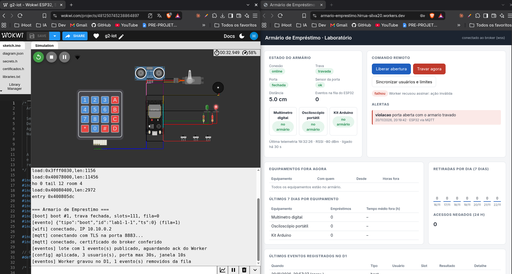

## 2 - MQTT Explorer

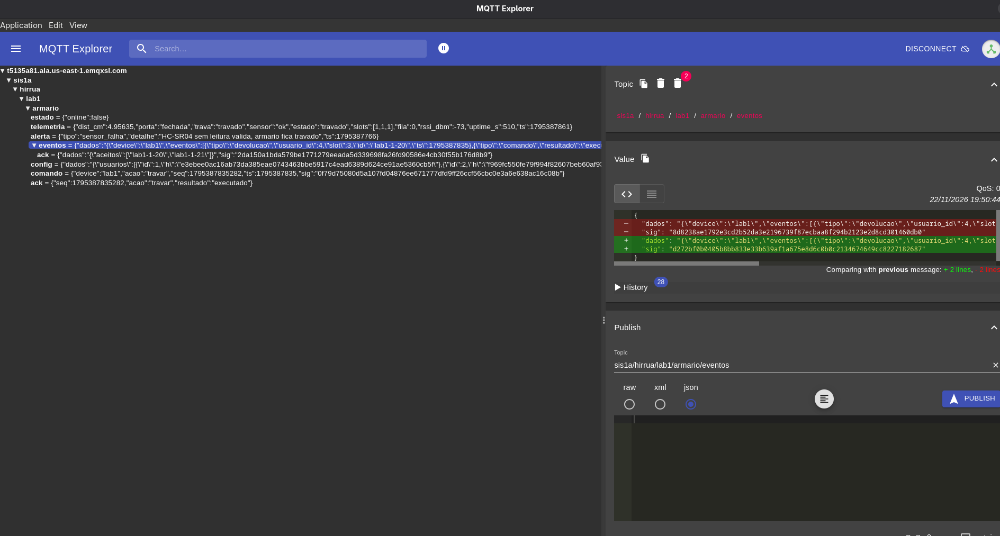

## 3 - Usuário Cadastrado

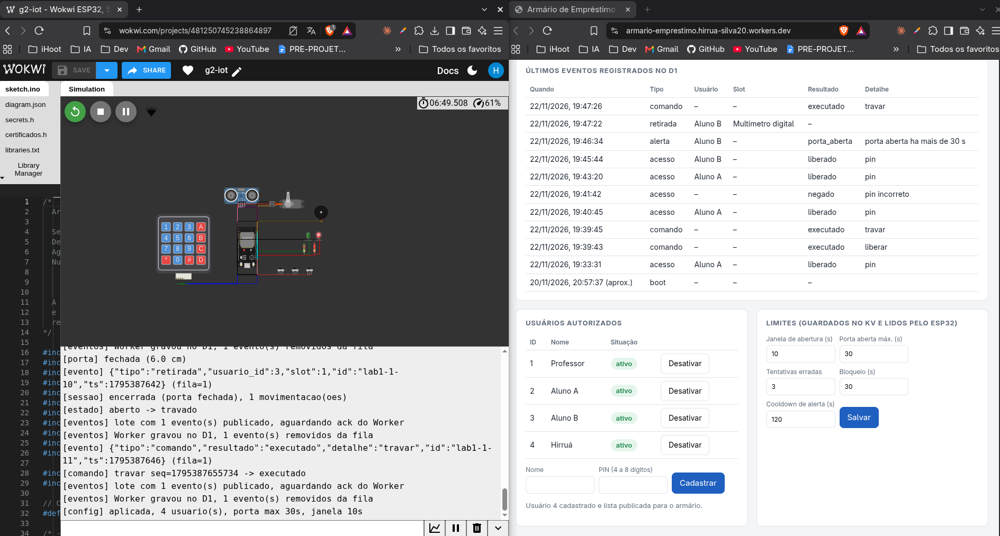

## 4 - Acesso Liberado

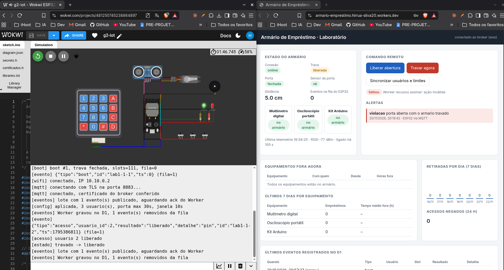

## 5 - Liberar Painel

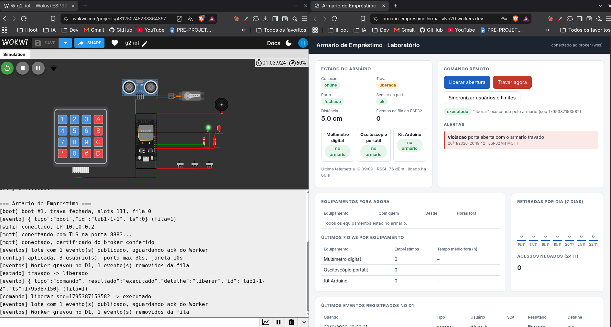

## 6 - Travando Painel

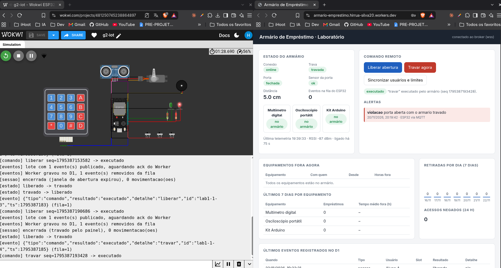

## 7 - Aluno A Liberando

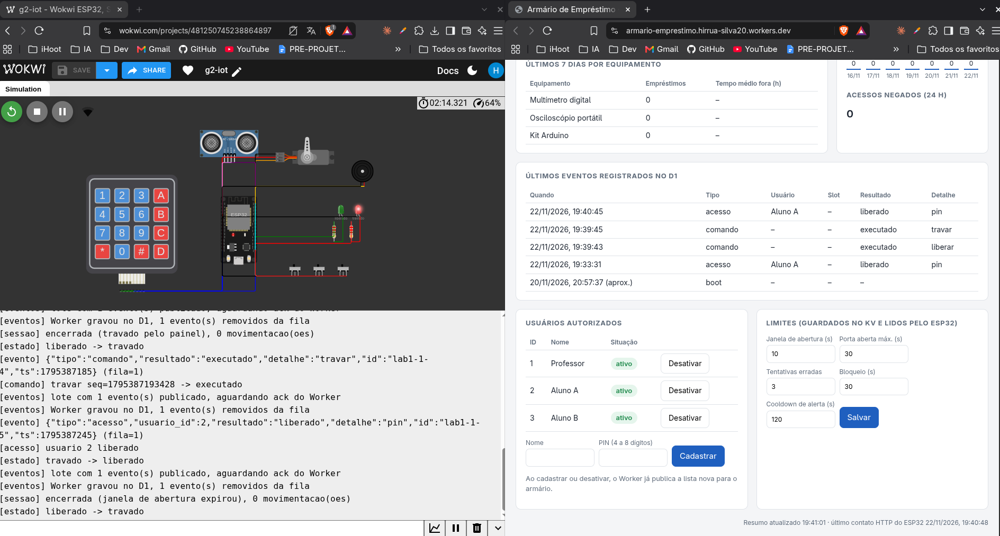

## 8 - Aluno A Negado

## 9 - Pegando Item

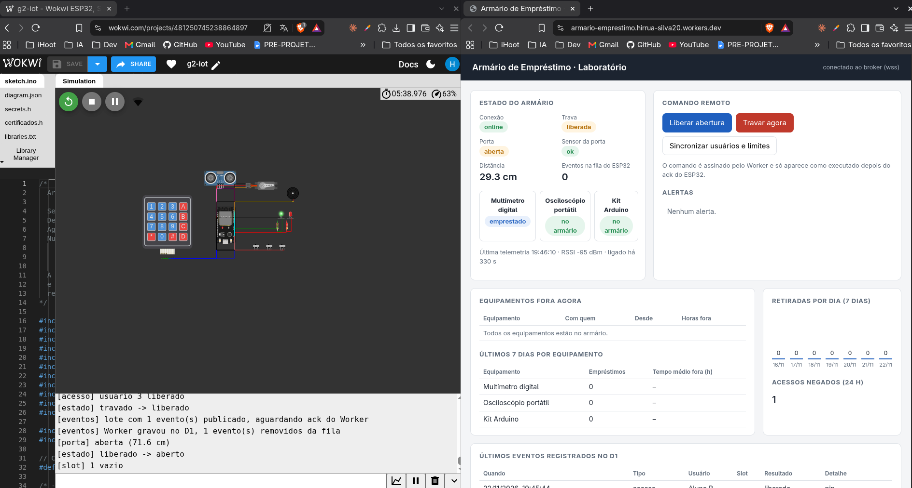

## 10 - Novo Usuário Pegando

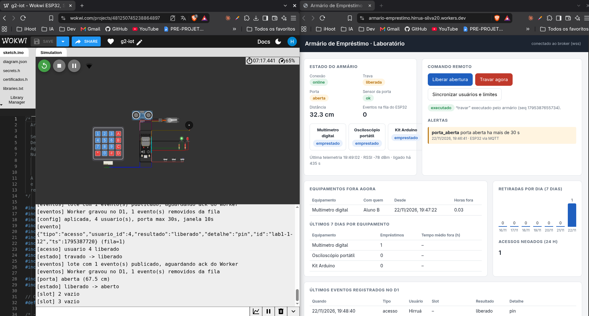

## 11 - Devolvendo Itens

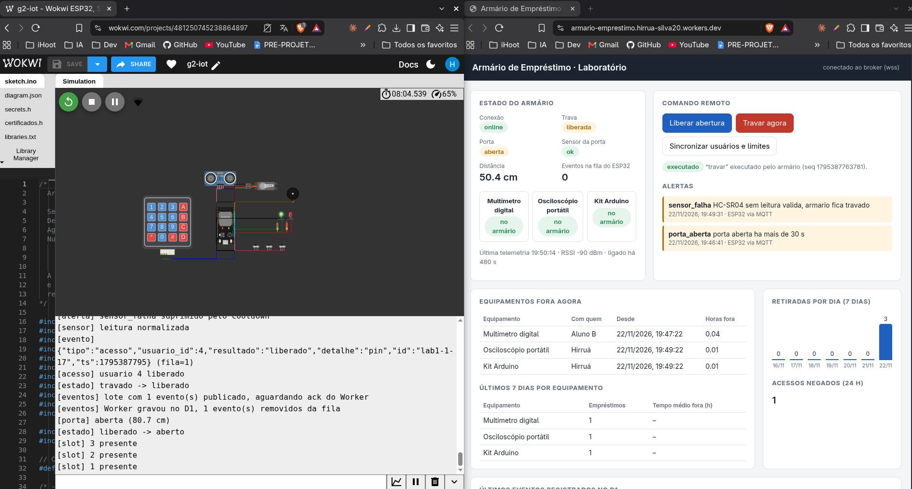

## 12 - Armário Aberto 30 Segundos

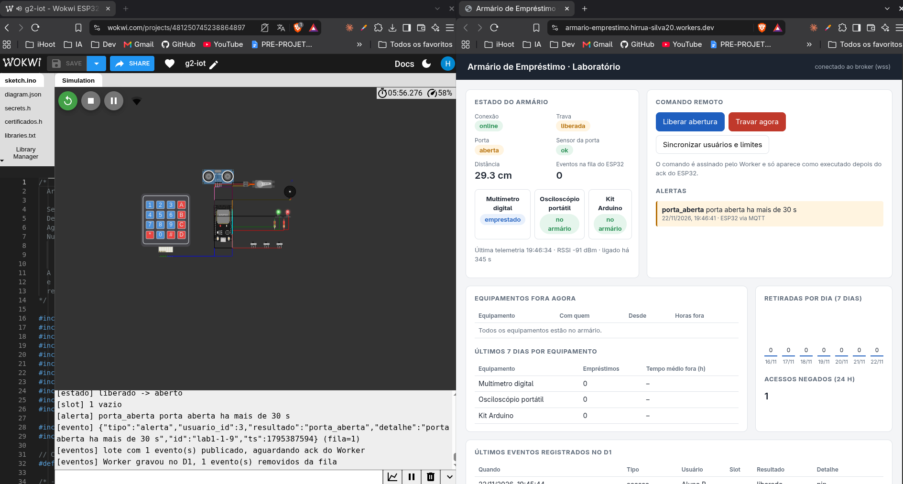

## 13 - Log Porta Aberta

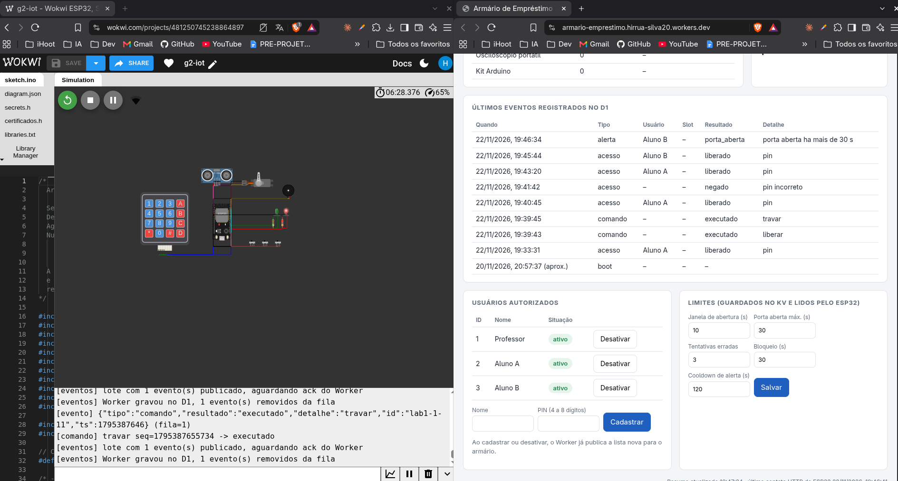

## 14 - Logs Armário

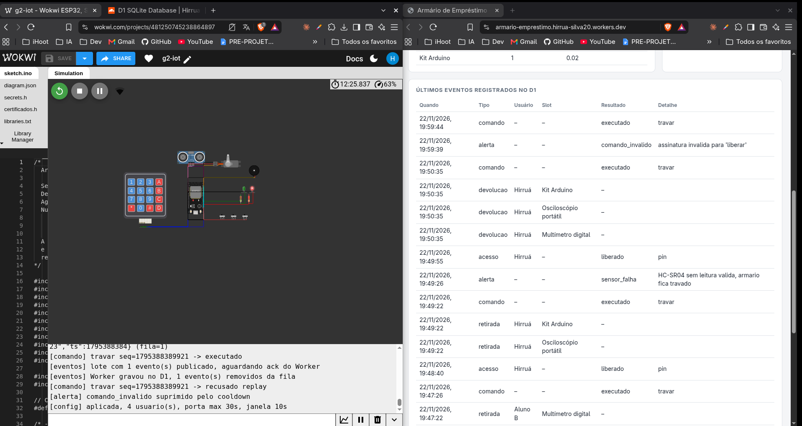

## 15 - Aviso Ataque

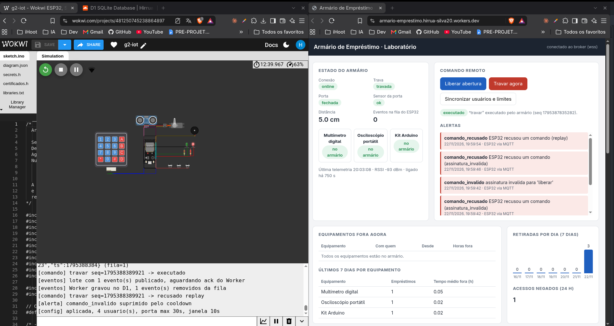

## 16 - Log Ataque

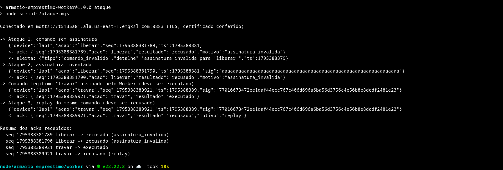

## 17 - Uso D1

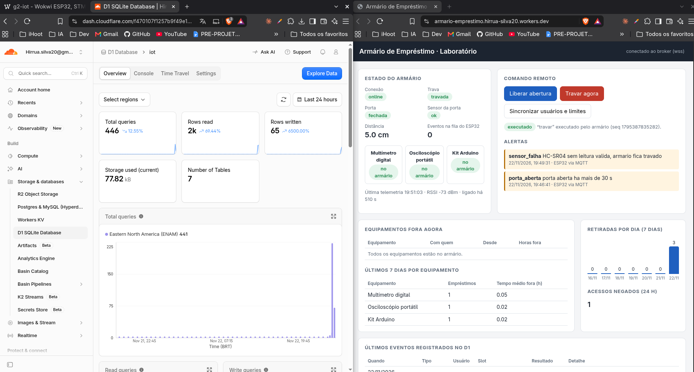

## 18 - D1 Tabela

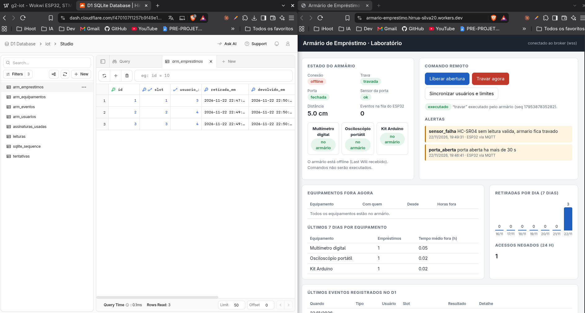

## 19 - D1 Querys

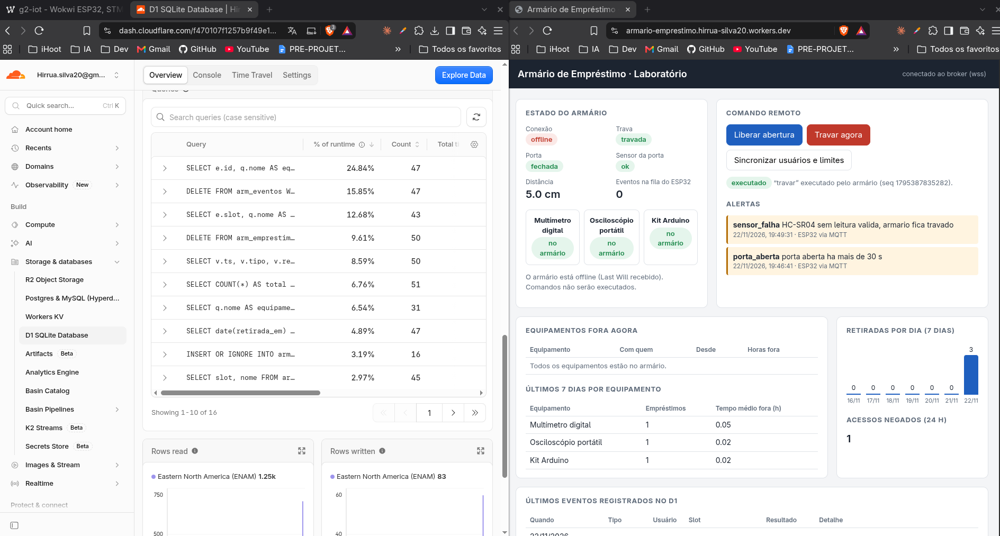
